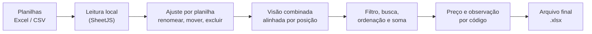

<div align="center">

# Painel de Cotação

**Painel web para abrir, organizar, alinhar e somar planilhas Excel de cotação — direto no celular ou no tablet, sem enviar nenhum dado para a internet.**

[](https://painelzenon.vercel.app/)


<!-- Substitua pelas capturas de tela reais (use dados fictícios!) -->
<!--  -->

</div>

---

## Sobre o projeto

Todo mês, um cliente envia planilhas de cotação **sem cabeçalho**, com número de colunas e ordem diferentes a cada arquivo e com as linhas desordenadas. O painel nasceu para resolver isso: abrir a planilha, dar nome às colunas, alinhar várias planilhas entre si, filtrar, somar quantidades, digitar preços e gerar um novo arquivo organizado.

O foco é o uso em **tablet e celular Android**, com botões grandes e leitura confortável. Tudo funciona **no próprio aparelho**: as planilhas não são enviadas a nenhum servidor.

## Funcionalidades

- **Várias planilhas** (`.xlsx`, `.xls`, `.csv`): lê todas as abas de cada arquivo e permite **marcar quais planilhas aparecem** na tabela.
- **Colunas dinâmicas**: o painel lê todas as colunas, sem presumir o que cada uma significa. Você pode **renomear, mover (◀ ▶) e excluir** colunas, e as colunas vazias são sinalizadas.
- **Ajuste por planilha**: com uma planilha marcada, as alterações valem só para ela. Com várias marcadas, elas aparecem **alinhadas pela posição das colunas** que você deixou em cada uma (o que é código fica sob código, o que é bairro fica sob bairro).
- **Colunas de Preço e Observação** criadas por você com o botão `+`. O painel pergunta qual coluna identifica o produto (por exemplo, o código), e o mesmo código recebe o mesmo valor em todas as linhas. O preço é formatado como `12,50`.
- **Filtro por coluna**: escolha uma coluna, veja os valores com a contagem de cada um (inclusive “só os que se repetem”) e marque os que devem aparecer. Não diferencia maiúsculas de minúsculas.
- **Busca**, **ordenação por qualquer coluna** e **soma de itens iguais** (você escolhe quais colunas identificam o item e qual é a quantidade).
- **Arquivo final `.xlsx`** com as linhas exibidas, na ordem da tela, com a coluna de preço em formato de moeda (R$) e códigos de barras preservados como texto.
- **PWA**: instalável pelo navegador, com funcionamento offline depois da primeira abertura.
- **Dados salvos no aparelho** (planilhas, nomes e ordem das colunas, preços e observações).

## Como funciona



## Tecnologias

- [React](https://react.dev/) (JavaScript) e [Vite](https://vitejs.dev/)
- [SheetJS (`xlsx`)](https://sheetjs.com/) para ler e gerar planilhas
- [`vite-plugin-pwa`](https://vite-pwa-org.netlify.app/) para o modo instalável e offline
- Hospedagem na [Vercel](https://vercel.com/) (cada `git push` publica)

## Como executar

Pré-requisito: [Node.js](https://nodejs.org/) (versão LTS).

```bash
# clonar
git clone https://github.com/<usuario>/<repositorio>.git
cd <repositorio>

# instalar dependências
npm install

# ambiente de desenvolvimento
npm run dev

# build de produção e pré-visualização
npm run build
npm run preview
```

Abra o endereço exibido no terminal (normalmente `http://localhost:5173`) e toque em **Adicionar planilha**.

## Como usar

1. **Adicione** uma ou mais planilhas.
2. Marque **só uma** e organize as colunas dela: dê nomes, mova e exclua o que não interessa.
3. Repita para a outra planilha.
4. Marque **as duas**: as colunas aparecem alinhadas, e as linhas são empilhadas.
5. Use **Filtro**, **Somar itens iguais** e o botão `+` para criar colunas de **Preço** e **Observação**.
6. Toque em **Gerar arquivo final** para baixar o `.xlsx` com o que está na tela.

## Estrutura do projeto

```text
src/
├── App.jsx                      # estado, visões (uma planilha ou combinação) e ações
├── App.css
├── components/
│   ├── ArquivosCarregados.jsx   # lista de planilhas e caixas de seleção
│   ├── CabecalhoColuna.jsx      # nome editável + ◀ ⇅ ▶ ✕ +
│   ├── DataTable.jsx            # tabela e células editáveis
│   ├── DialogoAdicionar.jsx     # criar coluna de preço/observação
│   ├── DialogoSoma.jsx          # somar itens iguais
│   ├── ErroTela.jsx             # mostra o erro em vez de tela preta
│   ├── FileLoader.jsx           # seleção de arquivos
│   ├── Modal.jsx
│   └── PainelFiltro.jsx         # filtro por coluna com contagem
├── hooks/
│   └── useLocalStorage.js       # estado persistido no aparelho
└── utils/
    ├── exportar.js              # preço (BR) e geração do .xlsx
    ├── layout.js                # modelo de colunas (nome, ordem, exclusões)
    ├── parseExcel.js            # leitura de todas as abas e colunas
    └── tabela.js                # valores de célula, ordenação, distintos e soma
```

## Privacidade

- As planilhas são lidas **no navegador**; nada é enviado a servidores.
- Os dados ficam no `localStorage` do aparelho e podem ser apagados limpando os dados do site.
- **Não versione planilhas reais.** Use apenas dados fictícios em exemplos, capturas de tela e testes.

## Limitações conhecidas

- Testado com planilhas de 7 a 11 colunas e algumas centenas de linhas. Planilhas muito grandes podem ficar lentas.
- O armazenamento do navegador é limitado (cerca de 5 MB); não há aviso quando o limite é atingido.
- Colunas de Preço e Observação pertencem à visão em que foram criadas (uma planilha ou a combinação).
- O pacote `xlsx` publicado no npm é uma versão antiga, com avisos de segurança conhecidos. Para arquivos locais e confiáveis o risco é baixo, mas convém reavaliar antes de uso mais amplo.

## Roadmap

- [x] Várias planilhas, colunas dinâmicas e ajuste por planilha
- [x] Filtro por coluna, soma de itens iguais e preços por código
- [x] PWA instalável
- [ ] APK assinado (TWA) para instalar sem o navegador
- [ ] Edição de células e reabertura do arquivo exportado
- [ ] Detecção automática de colunas (EAN, código, quantidade, bairro)
- [ ] Leitura de imagens (prints de planilha) com OCR no aparelho
- [ ] Dados de exemplo e botão “Carregar exemplo”
- [ ] Modo genérico para outros tipos de planilha

## Licença

A definir. <!-- Sugestão: MIT -->

## Autor

<!-- Seu nome e links (GitHub, LinkedIn) -->
